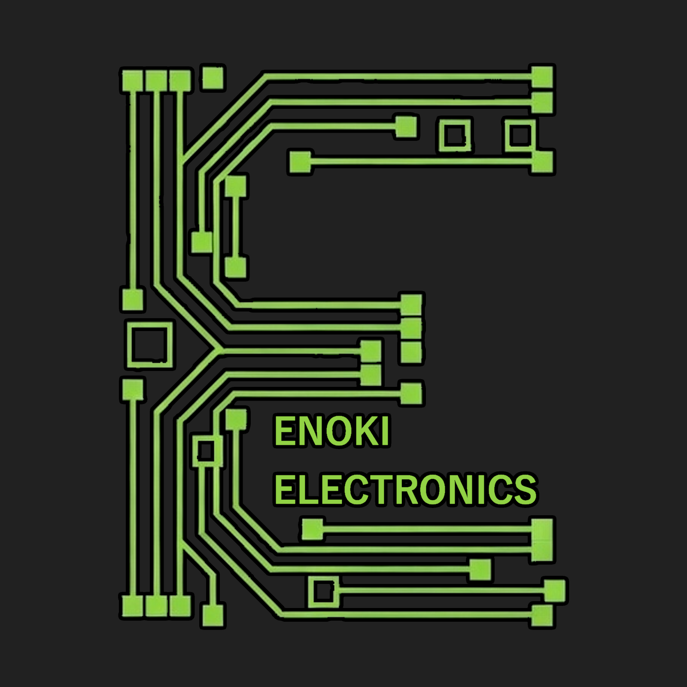

# エノキ電気 公式ホームページ

<p align="center">
  
</p>

<p align="center">
  
  
  
  
  
  
  
</p>

---

## 目次

1. [概要](#概要)
2. [主な機能・特徴](#主な機能特徴)
3. [アクセス](#アクセス)
4. [技術スタック](#技術スタック)
5. [ページ・ルーティング一覧](#ページルーティング一覧)
6. [ファイル・ディレクトリ構成](#ファイルディレクトリ構成)
7. [前提条件](#前提条件)
8. [環境構築・セットアップ](#環境構築セットアップ)
   - [1. リポジトリのクローンと依存解決](#1-リポジトリのクローンと依存解決)
   - [2. フロントエンド環境変数の設定 (.env)](#2-フロントエンド環境変数の設定-env)
   - [3. バックエンド設定 (env.php)](#3-バックエンド設定-envphp)
   - [4. データベースの用意 (MySQL)](#4-データベースの用意-mysql)
   - [5. 初回管理者 API トークンの発行](#5-初回管理者-api-トークンの発行)
9. [コンテンツ管理機能 (CMS: アプリ・音楽の一覧・編集・削除・ログアウト)](#コンテンツ管理機能-cms-アプリ音楽の一覧編集削除ログアウト)
10. [開発・コマンドリファレンス](#開発コマンドリファレンス)
11. [モバイルアプリ開発 (Capacitor 8)](#モバイルアプリ開発-capacitor-8)
12. [PWA (Progressive Web Apps)](#pwa-progressive-web-apps)
13. [バックエンド API エンドポイント一覧](#バックエンド-api-エンドポイント一覧)
14. [主要な設定箇所](#主要な設定箇所)
15. [デプロイガイド](#デプロイガイド)
16. [参考リンク・クレジット](#参考リンククレジット)

---

## 概要

**エノキ電気 公式ホームページ** は、ときえのき（エノキ電気）が運営するエノキ電気のホームページです。  
ユーザー登録・プロフィール管理・友達申請・QR コードによる友達追加・リアルタイムプッシュ通知（WebPush）などの多彩なソーシャル機能と、自身が制作したソフトウェアや楽曲の試聴・配信機能を備えています。

**Nuxt 4**（`compatibilityVersion: 4`）と **Capacitor 8** を採用したワンソース・マルチプラットフォーム構成となっており、同一のコードベースから **Web ブラウザ**、**PWA (Progressive Web Apps)**、および **Android / iOS ネイティブアプリ** を展開できます。

---

## 主な機能・特徴

- 📱 **マルチプラットフォーム展開**: Web、PWA、Android、iOS（Capacitor 8）に対応
- 👥 **ユーザー & ソーシャル機能**: アカウント登録、ログイン、パスワードリセット、プロフィール編集、友達申請・一覧管理
- 📷 **QR コード連携**:
  - `vue-qrcode-reader` によるカメラからの QR コード読み取り（対面での友達登録）
  - `qrcode` による自分専用 QR コードのリアルタイム生成
- 🔔 **WebPush プッシュ通知**:
  - Service Worker と WebPush API によるバックグラウンド通知の送受信
  - PHP バックエンド（`minishlink/web-push`）による通知配信基盤
- 🎨 **モダンかつ親しみやすい UI**:
  - Vuetify 3 + Pug + SCSS (`sass-embedded`)
  - Google Fonts「Zen Maru Gothic」を採用
  - ダークテーマ / ライトテーマ / システム連動の動的切り替え
  - **Android 15+ のエッジ・トゥ・エッジ (Edge-to-Edge) 対応**: ステータスバーやノッチ切り欠きに応じたパディング制御
- 🌐 **多言語対応 (i18n)**: `@nuxtjs/i18n` による日本語・英語のローカライズ対応
- 📚 **コンテンツ管理**: `@nuxt/content` (v3) による Markdown ページのコレクション管理
- 🛠️ **管理者向けコンテンツ管理 (CMS)**:
  - 管理者ログイン時（`/login`）のアプリ登録・音楽登録・編集・削除機能（FAB・設定・メニュー連動）
  - **音声ファイル（mp3 / wav / m4a 等）のサーバー側アップロード** & クライアント側自動 duration 解析
  - **画像（アイコン・サムネイル・カバー）の Base64 / URL 保存対応**（MySQL `mediumtext` 型による大容量データ保存）
  - **未完成フラグ (`isUnfinished`) & タグ (`tags`) 管理**: 開発中・制作途中のコンテンツの可視化と分類
  - アプリ・音楽メタデータおよび音声ファイル URL の **MySQL データベース管理**（`app_list`, `music_list`）
  - アップロードされた楽曲の本格インライン試聴・全体プレイヤー再生連携
  - **ボトムナビ「ようこそ」画面・設定画面からの管理者ログアウト**: PHP バックエンド（`logoutAccount.php`）と連携し、サーバー側のアクセストークンを安全に破棄
- 🔒 **セキュアな独自 API 認証**: API ID / Token / AccessKey によるリクエスト署名・認証機構

---

## アクセス

- **公式サイト**: <https://enoki.xyz>

---

## 技術スタック

| 分類                        | 技術 / ライブラリ                                             | バージョン / 補足                                                 |
| :-------------------------- | :------------------------------------------------------------ | :---------------------------------------------------------------- |
| **フレームワーク**          | [Nuxt 4](https://nuxt.com/)                                   | `^4.3.1` (4.6+, `compatibilityVersion: 4`, SSR / SSG）            |
| **フロントエンド基盤**      | [Vue.js](https://vuejs.org/)                                  | `^3.5` (Composition API & Options API)                            |
| **言語**                    | [TypeScript](https://www.typescriptlang.org/)                 | 完全型定義対応                                                    |
| **UI コンポーネント**       | [Vuetify 3](https://vuetifyjs.com/)                           | `vuetify-nuxt-module: ^0.19.5`, `@mdi/font: ^7.4.47`              |
| **テンプレート**            | [Pug](https://pugjs.org/)                                     | `^3.0.3`                                                          |
| **スタイル**                | [SCSS (sass-embedded)](https://sass-lang.com/)                | `^1.97.3`（Dart Sass 高速版）                                     |
| **状態管理**                | [Pinia](https://pinia.vuejs.org/)                             | `^3.0.4` + `@pinia-plugin-persistedstate/nuxt`（永続化）          |
| **国際化**                  | [@nuxtjs/i18n](https://i18n.nuxtjs.org/)                      | `^10.2.3`（日本語 / 英語）                                        |
| **コンテンツ管理**          | [@nuxt/content](https://content.nuxt.com/)                    | `^3.11.2` (Content v3) + `better-sqlite3: ^12.6.2`                |
| **モバイル / ネイティブ**   | [Capacitor](https://capacitorjs.com/)                         | `^8.1.0` (Core, CLI, App, Camera, Device, StatusBar, Toast, etc.) |
| **PWA**                     | Service Worker / Web App Manifest                             | オフライン対応、ホーム画面追加、プッシュ通知                      |
| **QR コード**               | `vue-qrcode-reader`, `qrcode`                                 | カメラ認識 (`^5.7.3`) & コード生成 (`^1.5.4`)                     |
| **リンター / フォーマッタ** | [@nuxt/eslint](https://eslint.nuxt.com/)                      | `^1.15.1` (Flat Config: `eslint.config.mjs`)                      |
| **バックエンド言語**        | [PHP](https://www.php.net/)                                   | 7.4 / 8.x + Composer                                              |
| **データベース**            | [MySQL](https://MySQL.com/) / MariaDB                     | PDO 接続、文字コード `utf8mb4`                                    |
| **メール送信**              | [PHPMailer](https://github.com/PHPMailer/PHPMailer)           | `^6.8` (SMTP 認証メール送信)                                      |
| **プッシュ通知送信**        | [web-push-php](https://github.com/web-push-libs/web-push-php) | `^8.0` (VAPID 認証 WebPush 送信)                                  |

---

## ページ・ルーティング一覧

| パス                          | ファイルパス                               | 内容・概要                                              |
| :---------------------------- | :----------------------------------------- | :------------------------------------------------------ |
| `/`                           | `app/pages/index.vue`                      | トップページ（ヒーローセクション、ピックアップ、最新コンテンツ等） |
| `/apps`                       | `app/pages/apps/index.vue`                 | ソフトウェア一覧ページ（カテゴリ別棚、ランキング、全アプリ） |
| `/apps/[appId]`               | `app/pages/apps/[appId].vue`               | ソフトウェア詳細画面（動的ルーティング）                |
| `/music`                      | `app/pages/music/index.vue`                | 音楽一覧ページ（楽曲・アルバム・ジャンル探索）          |
| `/music/[musicId]`            | `app/pages/music/[musicId].vue`            | 音楽詳細画面（動的ルーティング・シンセ試聴・歌詞）      |
| `/profile`                    | `app/pages/profile/index.vue`              | プロフィールページ（ときえのき経歴・実績・運営情報）    |
| `/sponsors`                   | `app/pages/sponsors.vue`                   | スポンサー・友人紹介ページ（支援者およびクリエイター仲間） |
| `/product`                    | `app/pages/product.vue`                    | トップページ（`/`）へのリダイレクト                     |
| `/info`                       | `app/pages/info.vue`                       | プロフィール（`/profile`）へのリダイレクト              |
| `/login`                      | `app/pages/login.vue`                      | 管理者ログイン画面（二段階メール認証）                  |
| `/registar`                   | `app/pages/registar.vue`                   | 管理者新規登録画面（管理者秘密キー・ワンタイム認証）    |
| `/password_reset`             | `app/pages/password_reset.vue`             | パスワード再設定画面                                    |
| `/user/[userId]`              | `app/pages/user/[userId].vue`              | ユーザープロフィール画面（動的ルーティング）            |
| `/friendlist`                 | `app/pages/friendlist.vue`                 | 友達リスト（申請中・承認済み一覧）                      |
| `/qrcode`                     | `app/pages/qrcode.vue`                     | QR コード友達検索 & 自分の QR コード表示                |
| `/settings`                   | `app/pages/settings/index.vue`             | 設定トップメニュー（管理者ログアウト対応）              |
| `/settings/profile`           | `app/pages/settings/profile.vue`           | プロフィール編集画面（名前・自己紹介・アイコン等）      |
| `/settings/display`           | `app/pages/settings/display.vue`           | 表示・言語設定（テーマ切替・言語選択）                  |
| `/settings/developer-options` | `app/pages/settings/developer-options.vue` | 開発者向けオプション（Android 15 ノッチ切り欠き検証等） |
| `/admin/manage`               | `app/pages/admin/manage.vue`               | コンテンツ管理（アプリ・音楽の一覧・編集・削除）        |
| `/admin/register`             | `app/pages/admin/register.vue`             | コンテンツ新規登録（アプリ・音楽登録・音声アップロード）|
| `/terms`                      | `app/pages/terms.vue`                      | 利用規約                                                |
| `/privacy`                    | `app/pages/privacy.vue`                    | プライバシーポリシー                                    |
| `/about`                      | `app/pages/about.vue`                      | 運営情報・プロフィール                                  |
| `/tutorial`                   | `app/pages/tutorial.vue`                   | アプリの使い方チュートリアル                            |
| `/[...slug]`                  | `app/pages/[...slug].vue`                  | 存在しないパスへのフォールバック（準備中画面）          |

---

## ファイル・ディレクトリ構成

Nuxt 4 の標準構造（`future: { compatibilityVersion: 4 }`）に基づき、Nuxt アプリケーション本体は `app/` 配下に集約されています。

```
enoki-homepage/
├── app/                                # Nuxt 4 アプリケーションルート
│   ├── app.vue                         # ルートコンポーネント（テーマ・スプラッシュ・OS別パディング制御）
│   ├── components/                     # Vue コンポーネント群
│   │   ├── common/
│   │   │   ├── BottomNav.vue           # ボトムナビゲーション & ようこそダイアログ（管理者ログアウト対応）
│   │   │   ├── commonSplash.vue        # アプリ起動時スプラッシュ画面
│   │   │   └── HeroProfile.vue         # ヒーロープロフィール表示
│   │   ├── store/                      # ソフトウェアストア向けコンポーネント群
│   │   │   ├── AppCard.vue             # アプリカード
│   │   │   ├── AppDetailModal.vue      # アプリ詳細モーダル
│   │   │   ├── AppRankItem.vue         # ランキング表示アイテム
│   │   │   ├── AppShelf.vue            # アプリシェルフ（横スクロール棚）
│   │   │   └── HeroBanner.vue          # おすすめヒーローバナー
│   │   ├── music/                      # 音楽プレイヤー向けコンポーネント群
│   │   │   ├── MiniPlayer.vue          # 画面下部ミニプレイヤー
│   │   │   ├── MusicCard.vue           # 楽曲カード
│   │   │   ├── MusicHeroBanner.vue     # 音楽おすすめバナー
│   │   │   ├── MusicShelf.vue          # 楽曲シェルフ（横スクロール棚）
│   │   │   ├── MusicTrackRow.vue       # トラック行（インライン試聴・再生対応）
│   │   │   ├── MusicView.vue           # 音楽トップ表示ビュー
│   │   │   └── NowPlayingModal.vue     # 全画面再生中モーダル
│   │   ├── admin/                      # 管理者専用コンポーネント群
│   │   │   └── AdminRegisterModal.vue  # アプリ・楽曲新規登録・編集モーダル（音声アップロード対応）
│   │   └── about/
│   │       └── AboutView.vue           # 運営情報ビュー
│   ├── data/                           # 初期モック・静的データ
│   │   ├── apps.json                   # アプリ・ゲーム初期データ
│   │   ├── music.json                  # 楽曲初期データ
│   │   ├── profile.ts                  # プロフィール初期データ（経歴・SNS等）
│   │   └── sponsors.ts                 # スポンサー・友人紹介データ
│   ├── pages/                          # ルーティング対応ページコンポーネント群
│   │   ├── index.vue                   # トップページ（ヒーローセクション・最新コンテンツ）
│   │   ├── apps/
│   │   │   ├── index.vue               # ソフトウェア一覧
│   │   │   └── [appId].vue             # ソフトウェア詳細
│   │   ├── music/
│   │   │   ├── index.vue               # 音楽一覧
│   │   │   └── [musicId].vue           # 音楽詳細
│   │   ├── login.vue                   # 管理者ログイン
│   │   ├── registar.vue                # 管理者新規登録
│   │   ├── password_reset.vue          # パスワードリセット
│   │   ├── friendlist.vue              # 友達リスト
│   │   ├── qrcode.vue                  # QR コード（スキャン・生成）
│   │   ├── sponsors.vue                # スポンサー・友人紹介
│   │   ├── terms.vue                   # 利用規約
│   │   ├── privacy.vue                 # プライバシーポリシー
│   │   ├── about.vue                   # 運営情報
│   │   ├── admin/                      # 管理者機能
│   │   │   ├── manage.vue              # コンテンツ管理（一覧・インライン試聴・編集・削除）
│   │   │   └── register.vue            # コンテンツ新規登録（アプリ・音楽・音声アップロード）
│   │   ├── info.vue                    # プロフィールへのリダイレクト
│   │   ├── profile/
│   │   │   └── index.vue               # プロフィール画面
│   │   ├── tutorial.vue                # チュートリアル
│   │   ├── [...slug].vue               # 準備中フォールバックルート
│   │   ├── settings/                   # 設定サブルート
│   │   │   ├── index.vue               # 設定トップ（管理者ログアウト対応）
│   │   │   ├── profile.vue             # プロフィール編集
│   │   │   ├── display.vue             # 表示・テーマ設定
│   │   │   └── developer-options.vue   # 開発者オプション
│   │   └── user/
│   │       └── [userId].vue            # ユーザープロフィール詳細
│   ├── stores/                         # Pinia 状態管理
│   │   ├── app.ts                      # アプリ全体状態・アプリ一覧データ
│   │   ├── meta.ts                     # メタ情報
│   │   ├── music.ts                    # 音楽プレイヤー状態・楽曲一覧・再生キュー
│   │   ├── myProfile.ts                # ログイン中ユーザー情報・管理者状態
│   │   ├── navigation.ts               # ボトムナビ・ダイアログ表示制御状態
│   │   └── settings.ts                 # 設定（テーマ・言語・開発者オプション、LocalStorage永続化）
│   ├── js/                             # ユーティリティモジュール
│   │   ├── Functions.ts                # 汎用ヘルパー（外部リンク・クリップボード等）
│   │   ├── ajaxFunctions.ts            # API 通信ラッパー（GET/POST・署名ヘッダー処理）
│   │   ├── contentApi.ts               # アプリ・音楽・音声アップロード・管理者ログアウト PHP 連携
│   │   ├── metaFunctions.ts            # クライアント側メタタグ動的更新
│   │   ├── setup.ts                    # サーバーサイド SEO メタ設定（useServerHead / useServerSeoMeta）
│   │   └── webpush.ts                  # WebPush 購読・トークン登録・Service Worker 連携
│   └── mixins/
│       └── mixins.ts                   # Vue Options API 用共通ミックスイン
├── assets/                             # アプリアイコン原画（Capacitor Assets 生成用）
│   ├── icon-background.png             # アイコン背景
│   ├── icon-foreground.png             # アイコン前景
│   └── icon-only.png                   # アイコン単体
├── php/                                # PHP API バックエンド
│   ├── functions/                      # 共通処理・関数群
│   │   ├── database.php                # DB 接続・CRUD・OTP生成などのコア関数
│   │   ├── authAPI.php / authAPIforUse.php         # API アクセス認証
│   │   ├── authAccount.php / authAccountforUse.php # ユーザーアカウント認証
│   │   ├── mailFunctions.php           # PHPMailer メール送信処理
│   │   └── push.php                    # WebPush 送信処理
│   ├── acceptFriend.php                # 友達申請承認
│   ├── authAccount.php                 # アカウント認証チェック
│   ├── createAccount.php               # 新規アカウント作成
│   ├── createTable.php                 # テーブル自動生成スクリプト
│   ├── deleteApp.php                   # アプリ情報 MySQL & JSON 削除 API
│   ├── deleteMusic.php                 # 音楽情報 MySQL & JSON 削除 API
│   ├── deletePushToken.php             # プッシュ通知トークン削除
│   ├── friendRequest.php               # 友達申請送信
│   ├── getApps.php                     # アプリ一覧 MySQL 取得 API
│   ├── getMusic.php                    # 楽曲一覧 MySQL 取得 API
│   ├── getMyFriendList.php             # 友達リスト取得
│   ├── getProfile.php                  # プロフィール情報取得
│   ├── insertPushToken.php             # プッシュ通知トークン登録
│   ├── loginAccount.php                # 管理者ログイン処理（二段階認証・トークン発行）
│   ├── logoutAccount.php               # 管理者ログアウト処理（アクセストークン削除）
│   ├── makeApiForAdmin.php             # 管理者用デフォルト API トークン初期発行
│   ├── myAutoLoad.php                  # Composer オートローダー読み込み
│   ├── registerApp.php                 # アプリ情報 MySQL 登録・更新 API
│   ├── registerMusic.php               # 楽曲情報 MySQL 登録・更新 API
│   ├── requestToken.php                # メール認証用ワンタイムトークン発行
│   ├── requestTokenForgotAccount.php   # パスワード忘れ認証トークン発行
│   ├── resetPassword.php               # パスワード再設定
│   ├── sendPushForAccount.php          # 指定ユーザーへのプッシュ通知送信
│   ├── sendPushForMe.php               # テスト用プッシュ通知送信
│   ├── settings.php                    # CORS・共通ヘッダー設定
│   ├── updateGeoLocation.php           # 位置情報更新
│   ├── updateProfile.php               # プロフィール更新
│   └── uploadAudio.php                 # 音声ファイル (mp3/wav) アップロード API
├── public/                             # 静的アセット（Web公開ディレクトリ）
│   ├── backgrounds/                    # トップページスライドショー用背景画像群
│   ├── data/                           # 公開データ（apps.json, music.json）
│   ├── icons/                          # PWA 用アプリアイコン群 (WebP: 48~512px)
│   ├── img/                            # サムネイル・画像素材
│   ├── sponsor/                        # スポンサー・友人ロゴ画像群
│   ├── uploads/                        # ユーザー・管理者アップロードファイル
│   │   ├── audio/                      # アップロードされた音声ファイル群 (mp3/wav/m4a等)
│   │   └── images/                     # アップロードされた画像ファイル群
│   ├── manifest.json                   # PWA Web App Manifest
│   ├── sw.js                           # PWA / WebPush 用 Service Worker
│   ├── favicon.ico                     # ファビコン
│   └── icon.png                        # メインアプリアイコン
├── server/                             # Nitro サーバーエンドポイント
│   └── api/
│       ├── upload-audio.post.ts        # 音声ファイル (mp3/wav) アップロード API
│       ├── upload-image.post.ts        # 画像ファイル アップロード API
│       ├── register-app.post.ts        # アプリ登録 API (ローカル JSON 反映)
│       ├── register-music.post.ts      # 音楽登録 API (ローカル JSON 反映)
│       ├── delete-app.post.ts          # アプリ削除 API (ローカル JSON 反映)
│       └── delete-music.post.ts        # 音楽削除 API (ローカル JSON 反映)
├── capacitor.config.ts                 # Capacitor 8 設定ファイル
├── content.config.ts                   # @nuxt/content (v3) コレクション定義
├── eslint.config.mjs                   # ESLint Flat Config 設定
├── nuxt.config.ts                      # Nuxt 4 設定ファイル
├── database.sql                        # MySQL スキーマ定義（全テーブル・ビュー・インデックス）
├── migration_admin.sql                 # 管理者権限追加用差分マイグレーション
├── migration_app_music.sql             # アプリ・音楽管理差分マイグレーション
├── migration_unfinished_tag.sql        # 未完成フラグ (`isUnfinished`)・タグ (`tags`) 追加差分マイグレーション
├── migration_content_mediumtext.sql    # Base64画像保存対応のためのカラム拡張 (`mediumtext`) 差分マイグレーション
├── env.example.php                     # PHP 側環境変数サンプル
├── .env.example                        # Nuxt 側環境変数サンプル
├── composer.json                       # PHP 依存関係定義
├── package.json                        # Node.js 依存関係・スクリプト定義
├── vercel.json                         # Vercel SPA リライト設定
└── yarn.lock                           # Yarn ロックファイル
```

---

## 前提条件

- **Node.js**: `20.x` 以上（LTS 推奨）
- **パッケージマネージャー**: `yarn`（v1.x Classic 推奨）
- **バックエンド API 実行時**:
  - **PHP**: `7.4` または `8.x`（PDO, cURL, OpenSSL, mbstring 拡張が必要）
  - **Composer**: `2.x`
  - **MySQL**: `5.7` 以上 または MariaDB `10.x` 以上
- **モバイルアプリ開発時**:
  - Android: **Android Studio**, JDK 17+
  - iOS: **macOS**, **Xcode**, CocoaPods

---

## 環境構築・セットアップ

### 1. リポジトリのクローンと依存解決

```bash
# リポジトリのクローン
git clone https://github.com/jikantoki/enoki-homepage.git
cd enoki-homepage

# Node パッケージのインストール
yarn install

# PHP パッケージのインストール（API を利用する場合）
composer install
```

> [!NOTE]
> `yarn install` 完了時に `nuxt prepare`（postinstall スクリプト）が自動実行され、`.nuxt` 内部の型定義が初期化されます。

---

### 2. フロントエンド環境変数の設定 (.env)

`.env.example` をコピーしてプロジェクトルートに `.env` を作成し、必要な値を設定します。

```bash
cp .env.example .env
```

#### `.env` の記述例:

```env
# WebPush 秘密鍵（サーバーサイド専用・クライアントには露出されません）
NUXT_WEBPUSH_PRIVATEKEY=your_webpush_private_key

# WebPush 公開鍵（クライアントで購読時に使用）
NUXT_WEBPUSH_PUBLICKEY=your_webpush_public_key

# API 設定（PHPバックエンドと通信するための認証情報）
NUXT_API_ID=default
NUXT_API_TOKEN=後述の手順5で生成されたトークン
NUXT_API_ACCESSKEY=後述の手順5で生成されたアクセスキー

# API サーバーのホスト URL（末尾スラッシュなし）
NUXT_API_HOST=https://api.yourdomain.com
```

> [!TIP]
> **WebPush 用の鍵ペアの生成方法**  
> 公開鍵・秘密鍵（VAPID キー）は [Web Push Codelab (Glitch)](https://web-push-codelab.glitch.me/) などのツールで即座に生成できます。

---

### 3. バックエンド設定 (env.php)

PHP バックエンドを使用する場合、リポジトリルート直下に `env.php` を作成します。  
`env.example.php` をコピーして作成し、データベースや SMTP メール送信設定、WebPush 設定を記入してください。

```bash
cp env.example.php env.php
```

#### `env.php` の主要な設定項目:

```php
<?php
// プロジェクトルートのディレクトリ名
define('DIRECTORY_NAME', '/');

// WebPush 設定（フロントエンドの .env と同じ鍵を指定）
define('NUXT_WebPush_PublicKey', 'パブリックキー');
define('NUXT_WebPush_PrivateKey', 'プライベートキー');
define('WebPush_URL', 'https://enoki.xyz');
define('WebPush_icon', 'https://enoki.xyz/icon.png');
define('Default_user_icon', 'https://enoki.xyz/account_default.jpg');

// MySQL データベース接続情報
define('MySQL_Host', 'localhost');
define('MySQL_DBName', 'your_database_name');
define('MySQL_User', 'your_database_user');
define('MySQL_Password', 'your_database_password');

// SMTP 送信設定（アカウント認証メール・パスワード再設定で使用）
define('SMTP_Name', 'エノキ電気');
define('SMTP_Username', 'smtp_user');
define('SMTP_Mailaddress', 'info@example.com');
define('SMTP_Password', 'smtp_password');
define('SMTP_Server', 'smtp.example.com');
define('SMTP_Port', 587);

// 管理者登録設定（管理者専用アカウント作成用セキュリティ）
define('Admin_Register_Key', '管理者登録用の秘密キー（半角英数記号）');
define('Admin_Register_Max', 1); // 登録可能な管理者アカウントの最大数（1で管理者本人のみ）
define('Admin_Allowed_Email', ''); // 特定のメールアドレスのみ許可する場合は指定（空欄ならキー検証のみ）

// メールヘッダー・フッター
$mailHeader = "<p>いつも エノキ電気 公式ホームページ をご利用いただきありがとうございます。<hr></p>";
$mailFooter = "<p><hr>このメールに返信することはできません。<br><a href=\"https://enoki.xyz\">エノキ電気</a></p>";
```

#### PHP サーバーの Apache / .htaccess 設定例:

API 用サブドメインのドキュメントルートを `php/` ディレクトリに向けるか、以下の `.htaccess` でルーティングと CORS を許可します。

```htaccess
<IfModule mod_rewrite.c>
  RewriteEngine on
  RewriteBase /
  RewriteRule ^$ php/ [L]
  RewriteCond %{REQUEST_FILENAME} !-f
  RewriteCond %{REQUEST_FILENAME} !-d
  RewriteRule ^(.+)$ php/$1 [L]
</IfModule>

# CORS 許可
Header append Access-Control-Allow-Origin: "*"
Header append Access-Control-Allow-Headers: "*"
```

---

### 4. データベースの用意 (MySQL)

リポジトリルートにある `database.sql` を MySQL データベースにインポートします。

```bash
mysql -u your_user -p your_database_name < database.sql
```

> [!NOTE]
> phpMyAdmin をご利用の場合は、作成したデータベースを選択して「インポート」タブから `database.sql` をアップロードするだけで完了します。
>
> **作成される主要テーブル:**
>
> - `accounts` / `user_list` / `user_profile_list`: ユーザー基本情報・プロフィール
> - `user_accesstoken_list`: ログイン中アクセストークン管理
> - `follow_list`: 友達申請・登録ステータス
> - `push_token_list`: プッシュ通知送信用トークン一覧
> - `location_list`: ユーザー位置情報
> - `api_list`: API 認証キー（ID・トークン・ハッシュ化アクセスキー）
> - `app_list`: アプリ・ゲーム情報（価格・プラットフォーム・外部リンク・画像URL・未完成フラグ・タグ）
> - `music_list`: 楽曲情報・サーバー上音声ファイルURL（mp3/wav/m4a等）・歌詞・ジャケット画像・未完成フラグ・タグ

#### 既存データベースからの差分更新 (マイグレーション)

すでに既存のデータベースを運用中の場合は、必要に応じて以下の差分マイグレーション SQL を順番に実行してください。

1. **アプリ・音楽管理テーブルの追加**:
   ```bash
   mysql -u your_user -p your_database_name < migration_app_music.sql
   ```
2. **未完成フラグ (`isUnfinished`) & タグ (`tags`) カラムの追加**:
   ```bash
   mysql -u your_user -p your_database_name < migration_unfinished_tag.sql
   ```
3. **画像カラムの拡張 (`mediumtext` による Base64 対応)**:
   ```bash
   mysql -u your_user -p your_database_name < migration_content_mediumtext.sql
   ```

> [!TIP]
> phpMyAdmin をご利用の場合は、「インポート」タブから該当の `.sql` ファイルを選択して実行することで、既存データを保持したまま安全にカラムやテーブルが追加・拡張されます。

---

### 5. 初回管理者 API トークンの発行

本アプリの API 通信は独自の署名・認証機構を持っています。初回セットアップ時に管理者用デフォルト API を発行します。

1. セットアップした API サーバーの `/makeApiForAdmin.php`（例: `https://api.yourdomain.com/makeApiForAdmin.php`）にブラウザでアクセスします。
2. 初回アクセス時のみ MySQL の `api_list` テーブルにレコードが自動生成され、画面上に **API Token** と **AccessKey** が表示されます。
3. 表示された内容をコピーし、フロントエンドの `.env` の `NUXT_API_TOKEN` および `NUXT_API_ACCESSKEY` に貼り付けます。

> [!WARNING]
> AccessKey はハッシュ化されて保存されるため、画面を閉じると後から再確認できません。必ずメモを残してください。  
> 紛失した場合は、MySQL の `api_list` および `api_listForView` から `secretId='default'` の行を削除し、再度 `/makeApiForAdmin.php` にアクセスして再生成してください。

---

## コンテンツ管理機能 (CMS: アプリ・音楽の一覧・編集・削除・ログアウト)

管理者アカウント（`role === 'admin'` または `canRegisterApp === true`）でログインしている場合、専用のコンテンツ管理機能が利用可能です。

### 1. 管理ページ (`/admin/manage`)
- **一覧表示**: 登録済みアプリ・ゲームおよび楽曲をタブ形式で素早く閲覧・検索・カテゴリ/ジャンル絞り込み。
- **インライン試聴**: 音楽一覧では、サーバーにアップロードされた音声ファイルの有無をバッジ表示し、その場ですぐに試聴可能。
- **クイックアクション**: 各アイテムの「詳細ページを開く」「編集」「削除」をワンクリックで実行可能。
- **新規登録への導線**: ヘッダーおよびリスト上部からワンクリックで登録モーダルを開くことが可能。

### 2. 編集・登録機能
- 管理ページ（`/admin/manage`）の「編集」ボタン、ボトムナビ「アプリ・音楽を登録」、または各詳細画面（`/apps/[appId]`, `/music/[musicId]`）の管理者バーからモーダルを呼び出せます。
- 名前、ID、価格、画像（URL または Base64）、外部リンク、音声URL、作詞・作曲、歌詞、**未完成フラグ (`isUnfinished`)**、**タグ一覧 (`tags`)** などをフォームから手軽に編集・保存可能。
- 保存を実行すると、MySQL データベースのレコードが `ON DUPLICATE KEY UPDATE` により更新され、サーバー側 JSON ファイルおよび Pinia ストアへ即座に反映されます。

### 3. 安全な削除機能
- 管理ページ（`/admin/manage`）または詳細画面（`/apps/[appId]`, `/music/[musicId]`）の「削除」ボタンをクリックすると、確認ダイアログが表示されます。
- 削除を確定すると、以下の処理が安全に実行されます:
  1. **MySQL データベース**: `app_list` / `music_list` テーブルから該当レコードを物理削除 (`deleteApp.php` / `deleteMusic.php`)
  2. **サーバー JSON ファイル**: `app/data/apps.json`、`app/data/music.json`（および `public/data/`）から除外して保存 (`/api/delete-app` / `/api/delete-music`)
  3. **Pinia 状態管理**: クライアントキャッシュから即座に削除（再生中楽曲の場合は安全に再生停止）

### 4. 管理者ログアウト機能
- **「ようこそ」画面（ボトムナビの「その他」）**: 管理者でログインしている場合、管理者アイコンや表示名、バッジと共に**「管理者ログアウト」**ボタンが表示されます。
- **設定画面 (`/settings`)**: 設定一覧の中にも「管理者ログアウト」ボタンが常時表示されます。
- ログアウトを実行すると、確認ダイアログが表示された上で、**PHP バックエンド（`logoutAccount.php`）を呼び出して MySQL の `user_accesstoken_list` からアクセストークンを完全に破棄**し、クライアント側のセッション（Pinia ストア）をリセットして安全にゲスト状態へ戻ります。

### 5. 管理者向けナビゲーション導線
- **ボトムナビ「その他（ようこそ）」**: 「コンテンツ管理 (編集・削除)」、「アプリ・音楽を登録」、「管理者ログアウト」
- **設定画面 (`/settings`)**: 管理者ログイン時に「コンテンツ管理」「コンテンツ新規登録」「管理者ログアウト」を表示
- **一覧画面 (`/apps`, `/music`)**: 画面右下に管理者用 FAB ボタン（登録 `+` および 管理リストアイコン）を常時表示
- **詳細画面 (`/apps/[appId]`, `/music/[musicId]`)**: 管理者限定のアクションバナーおよびツールバー編集・削除ボタンを表示

---

## 開発・コマンドリファレンス

`package.json` に定義されている開発・ビルドコマンド一覧です。

| コマンド                | 説明                                                                         |
| :---------------------- | :--------------------------------------------------------------------------- |
| `yarn dev`              | ローカル開発サーバーを起動（`http://localhost:10000`）                       |
| `yarn build`            | 本番用 Nuxt アプリケーションをビルド（SSR モード）                           |
| `yarn generate`         | 静的プリレンダリングを行い、`dist/` ディレクトリを生成（SPA / SSG）          |
| `yarn preview`          | `yarn build` または `yarn generate` で生成した成果物をローカルでプレビュー   |
| `yarn lint`             | ESLint によるコード静的解析・構文チェックを実行                              |
| `yarn typecheck`        | `nuxt typecheck` による TypeScript 型整合性チェックを実行                    |
| `yarn cap:sync`         | `nuxt generate` を実行後、成果物を Capacitor ネイティブプロジェクトに同期    |
| `yarn cap:open:android` | Android Studio を起動してネイティブプロジェクトを開く                        |
| `yarn cap:open:ios`     | Xcode を起動してネイティブプロジェクトを開く                                 |
| `yarn postinstall`      | `nuxt prepare` を実行し、Nuxt の型マッピングを生成（インストール時自動実行） |

---

## モバイルアプリ開発 (Capacitor 8)

Capacitor 8 を使用して、Web の資産を Android / iOS アプリとしてビルドできます。

### 1. ネイティブプラットフォームの初回追加

リポジトリクローン直後など、ネイティブフォルダ（`android/`, `ios/`）が存在しない場合は初回のみ追加コマンドを実行します。

```bash
# Android プラットフォームを追加
npx cap add android

# iOS プラットフォームを追加 (macOS のみ)
npx cap add ios
```

### 2. Web アセットの生成と同期

コードの変更をネイティブプロジェクトに反映するには `yarn cap:sync` を実行します。

```bash
yarn cap:sync
```

このコマンドは内部で `nuxt generate`（`dist/` への静的出力）を行い、Capacitor がそのファイルをネイティブプロジェクトへコピーします。

### 3. IDE でのビルド・実行

```bash
# Android Studio で開く
yarn cap:open:android

# Xcode で開く (macOS のみ)
yarn cap:open:ios
```

IDE が起動したら、エミュレータまたは実機を選択して実行・デバッグを行います。

### 4. アプリアイコン・スプラッシュ画面の生成

`assets/` ディレクトリ内の画像素材を元に、各プラットフォーム向けのアプリアイコンとスプラッシュ画面を自動生成できます。

```bash
npx @capacitor/assets generate
```

---

## PWA (Progressive Web Apps)

本プロジェクトは PWA（Progressive Web App）に対応しています。

- **Service Worker (`public/sw.js`)**:
  - 静的アセットのキャッシュ
  - WebPush プッシュ通知のバックグラウンド受信・通知バナーのタップハンドリング
- **Web App Manifest (`public/manifest.json`)**:
  - ホーム画面への追加（Standalone 起動対応）
  - 各種解像度（48px〜512px）の WebP アプリアイコン対応
- **Vercel リライト (`vercel.json`)**:
  - クライアントサイドルーティング（SPA / PWA）のための `index.html` フォールバックリライト設定済み

ブラウザでアクセスした際、アドレスバーやメニューから「ホーム画面に追加」または「アプリをインストール」を選択することで、ネイティブアプリ感覚で利用できます。

---

## バックエンド API エンドポイント一覧

PHP バックエンド（`php/`）に用意されている主なエンドポイントです。フロントエンドからは `app/js/contentApi.ts` または `app/js/ajaxFunctions.ts` を経由してリクエストが行われます。

| カテゴリ             | エンドポイント                  | 説明                                       |
| :------------------- | :------------------------------ | :----------------------------------------- |
| **認証・アカウント** | `loginAccount.php`              | 管理者ログイン認証（メール二段階認証・トークン発行） |
|                      | `logoutAccount.php`             | 管理者/ユーザーのログアウト処理（アクセストークンの削除） |
|                      | `authAccount.php`               | アクセストークンの妥当性検証               |
|                      | `createAccount.php`             | 新規アカウントの本登録                     |
|                      | `requestToken.php`              | 新規登録・ログイン時のメール認証コード送信 |
| **パスワード**       | `requestTokenForgotAccount.php` | パスワードリセット用認証コード送信         |
|                      | `resetPassword.php`             | パスワードの再設定実行                     |
| **プロフィール**     | `getProfile.php`                | ユーザープロフィールの取得                 |
|                      | `updateProfile.php`             | プロフィール情報の更新（名前・自己紹介等） |
| **ソーシャル・友達** | `friendRequest.php`             | 友達申請の送信                             |
|                      | `acceptFriend.php`              | 友達申請の承認                             |
|                      | `getMyFriendList.php`           | 友達一覧・申請中リストの取得               |
| **プッシュ通知**     | `insertPushToken.php`           | WebPush 購読トークンの登録・更新           |
|                      | `deletePushToken.php`           | WebPush 購読トークンの解除                 |
|                      | `sendPushForAccount.php`        | 特定のユーザーへのプッシュ通知送信         |
|                      | `sendPushForMe.php`             | 自分宛てのテスト通知送信                   |
| **位置情報**         | `updateGeoLocation.php`         | ユーザーの位置情報（緯度・経度）更新       |
| **システム・管理**   | `makeApiForAdmin.php`           | 管理者用 API トークンの初期生成            |
|                      | `createTable.php`               | DB テーブル自動初期化                      |
| **コンテンツ管理**   | `uploadAudio.php`               | 音声ファイル (mp3/wav/m4a等) サーバー側アップロード API |
|                      | `registerApp.php`               | アプリ情報 MySQL 登録・更新 API            |
|                      | `registerMusic.php`             | 楽曲・音声ファイルURL MySQL 登録・更新 API |
|                      | `deleteApp.php`                 | アプリ情報 MySQL & JSON 物理削除 API       |
|                      | `deleteMusic.php`               | 楽曲情報 MySQL & JSON 物理削除 API         |
|                      | `getApps.php`                   | アプリ一覧 MySQL 取得 API                  |
|                      | `getMusic.php`                  | 楽曲一覧 MySQL 取得 API                    |

---

## 主要な設定箇所

| 設定項目                    | 設定対象ファイル          | 内容                                                          |
| :-------------------------- | :------------------------ | :------------------------------------------------------------ |
| **Nuxt 全般・モジュール**   | `nuxt.config.ts`          | Nuxt 4 モード設定、i18n 言語設定、Vuetify 設定、OGP・メタタグ |
| **Capacitor モバイル設定**  | `capacitor.config.ts`     | App ID (`xyz.enoki.home`)、アプリ表示名、Web 出力先 (`dist`)  |
| **コンテンツ管理設定**      | `content.config.ts`       | `@nuxt/content` (v3) のコレクション定義                       |
| **コード規約・ESLint**      | `eslint.config.mjs`       | `@nuxt/eslint` のフラットコンフィグ設定                       |
| **テーマカラー・フォント**  | `app/app.vue`             | `--v-theme-primary: 225, 35, 120`、Zen Maru Gothic            |
| **環境変数 (フロント)**     | `.env` / `nuxt.config.ts` | WebPush キー、API ホスト、API トークン                        |
| **環境変数 (バックエンド)** | `env.php`                 | DB 接続情報、SMTP メールサーバー情報、WebPush 秘密鍵          |
| **PWA マニフェスト**        | `public/manifest.json`    | アプリ名称、テーマカラー、アイコン定義                        |

---

## デプロイガイド

### フロントエンド (Vercel)

1. Vercel にリポジトリを連携します。
2. Framework Preset として **Nuxt** または **Other** を選択します。
3. **Environment Variables** に `.env` に記載した環境変数を設定します。
   - `NUXT_WEBPUSH_PUBLICKEY`
   - `NUXT_WEBPUSH_PRIVATEKEY`
   - `NUXT_API_ID`
   - `NUXT_API_TOKEN`
   - `NUXT_API_ACCESSKEY`
   - `NUXT_API_HOST`
4. ビルドコマンドは `yarn generate`（SPA/PWA 静的ホスティング）または `yarn build`（SSR ホスティング）を指定します。
   - 本リポジトリには `vercel.json` が含まれており、SPA / PWA 形式で安全に全ルートを `index.html` にフォールバックします。

### バックエンド (PHP / Apache / Nginx)

1. レンタルサーバーや VPS の任意のドメイン / サブドメインに `php/` 配下のファイル一式を配置します。
2. ルートディレクトリに `env.php` を配置し、DB・SMTP 接続情報を正しく設定します。
3. `database.sql` を MySQL にインポートします（既存DBの場合は差分マイグレーション SQL を実行）。
4. `/makeApiForAdmin.php` にアクセスし、生成されたトークンをフロントエンドの `.env` に反映します。

---

## 参考リンク・クレジット

- **運営・開発**: [エノキ電気 (ときえのき)](https://enoki.xyz)
- **公式ドキュメント**:
  - [Nuxt Documentation](https://nuxt.com/docs)
  - [Capacitor Documentation](https://capacitorjs.com/docs)
  - [Vuetify 3 Documentation](https://vuetifyjs.com/)
  - [Nuxt Content Documentation](https://content.nuxt.com/)
  - [Web Push Libs PHP](https://github.com/web-push-libs/web-push-php)
